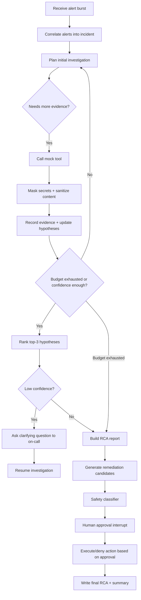

# Architecture Proposal: Autonomous Incident Triage & RCA Agent

## 1) Proposed approach

I recommend a LangGraph-based orchestration layer with a strongly typed state schema and a narrow, tool-budgeted investigation loop. This fits the prompt because the problem is inherently stateful, branching, and interrupt-driven: the agent must correlate alerts, choose the next evidence-gathering step, rank root-cause candidates, ask clarifying questions when confidence is low, and pause for human approval before any remediation.

I will implement the system as a model-agnostic agent wrapper around a local Ollama/Qwen3 provider, while keeping the graph logic independent of the concrete model. The architecture intentionally treats the LLM as a reasoning component, not as the safety authority.

## 2) Core architecture

### 2.1 High-level components

1. Incident intake and alert correlation
   - Accepts a burst of alerts and groups them by service dependency and time window.
   - Builds a candidate incident cluster, rather than treating each alert as a standalone event.

2. Dependency-aware evidence planner
   - Uses service topology to decide which services to investigate first.
   - Chooses tools based on the most informative missing evidence instead of a flat exhaustive search.

3. Mock evidence tools
   - `query_logs(service, time_range, filter)`
   - `get_metrics(service, metric, window)`
   - `get_recent_deployments(service, time_range)`
   - `get_config_changes(service, time_range)`
   - `get_dependency_graph()`
   - `search_runbooks(query)`
   - These are plain in-process functions backed by synthetic fixtures and optional timeout/error simulation.

4. Guardrail layer
   - Secret masking happens before any log content leaves the process boundary.
   - Prompt-injection text in logs is treated as data only; not executed.
   - Safe/Risky/Forbidden classification is enforced by code, not by LLM judgment.

5. Hypothesis engine
   - Generates candidate root causes from the evidence set.
   - Keeps a reasoned evidence ledger showing which findings support/discard each hypothesis.
   - Always outputs a ranked top-3 list with confidence values.

6. Human approval gate
   - Every remediation candidate pauses at a controlled interrupt.
   - Action payload includes safety tier, summary, and required justification for Risky actions.

7. Post-incident RCA writer
   - Produces a structured narrative and remediation recommendations suitable for a review.

8. Evaluation harness
   - Runs the system across synthetic scenarios and reports: root-cause accuracy, correlation precision, citation correctness, tool-call efficiency, and unsafe-action rate.

## 3) State schema

The graph will use a strongly typed state object such as:

```python
class IncidentState(TypedDict):
    incident_id: str
    raw_alerts: list[Alert]
    incident_clusters: list[IncidentCluster]
    active_cluster_id: str | None
    dependency_graph: dict
    evidence: dict[str, list[EvidenceItem]]
    tool_budget: dict[str, int]
    tool_usage: dict[str, int]
    candidate_hypotheses: list[Hypothesis]
    ranked_hypotheses: list[Hypothesis]
    confidence: float
    clarification_questions: list[str]
    runbook_matches: list[dict]
    proposed_actions: list[ActionProposal]
    human_decision: dict | None
    report: dict | None
    trace_events: list[dict]
    stop_reason: str | None
```

This state keeps the investigation path inspectable and makes the budget logic deterministic.

## 4) Investigation flow



## 5) Graph states and stop conditions

### Stage A: Intake and clustering
- Input: raw alert burst and dependency graph.
- Determine whether multiple alerts belong to the same incident by shared service path and temporal proximity.
- Stop condition: cluster set is finalized and a single root incident is active.

### Stage B: Investigation planner
- Uses the dependency graph to prioritize likely root cause services.
- Chooses the next most informative tool based on missing information and prior evidence.
- Avoids redundant calls by caching tool responses keyed by service + query signature.

### Stage C: Evidence gathering
- Executes one justified tool call at a time.
- Each response is normalized into evidence objects with service, timestamp, source, and source-specific details.
- Stop condition: no high-value missing fact remains, or the tool budget is reached.

### Stage D: Hypothesis reasoning
- Creates root-cause candidates from evidence patterns such as deployment changes, resource saturation, certificate state, queue lag, config variances, and dependency failures.
- Explicitly records for each candidate:
  - evidence supporting it
  - evidence contradicting it
  - final decision: kept / rejected / uncertain
- Always emits a ranked top-3 ordered list with confidence scores.
- Stop condition: top-3 ranking is stable and the evidence ledger is complete enough to justify it.

### Stage E: Clarification gate
- If confidence is below a defined threshold, ask a targeted question instead of guessing.
- Example: ask about deployment timing, recent config change, or whether a related service is also degraded.
- Stop condition: the answer clarifies the missing fact or the agent proceeds with best-effort report plus note of uncertainty.

### Stage F: Remediation and approval
- Uses a hard-coded classification logic to label actions as Safe / Risky / Forbidden.
- Every action requires a human interrupt before execution.
- Risky actions require written justification; Safe actions do not, but still require a single confirmation click.
- Forbidden actions are never surfaced as executable actions.

### Stage G: Final report generation
- Produces a timeline, blast radius, top-3 candidates, evidence citations, and the final incident summary.

## 6) Tool budget and bounded investigation

I will enforce a strict per-incident budget to satisfy NFR-1, with a default plan like:

- max tool calls per incident: 12
- max LLM reasoning turns per incident: 6
- max output tokens per run: 3,000-5,000 depending on the selected model

These budgets are intentionally conservative for a 4B local model and are documented as part of the design. If the budget is exhausted, the system degrades gracefully, returning its best evidence-backed ranking and confidence without retry loops.

## 7) Guardrails and safety decisions

### Secret masking
- Built as a deterministic regex-based preprocessor applied before any log content is sent to the LLM or exported to external observability.
- Masks credentials, connection strings, API keys, and token-like patterns.
- Applies consistently to all outbound boundaries.

### Injection resistance
- Synthetic logs may include strings that mimic instruction text.
- The agent will never execute any log content as instructions; it will treat it as untrusted observational data.
- Injection examples are included in test scenarios and explicitly validated.

### Safety classification
- The classifier is code-driven, not model-driven.
- Examples:
  - Safe: `restart_pod`, `flush_cache`, `restart_worker`
  - Risky: `rollback_release`, `change_config`, `drain_node`
  - Forbidden: `delete_data`, `drop_table`, `purge_queue`, `disable_auth`
- The LLM may propose actions, but the system decides the tier and blocks execution without human confirmation.

## 8) Model abstraction and Ollama setup

I will create a provider abstraction layer:

```python
class LLMProvider(Protocol):
    def generate(self, prompt: str, schema: type | None = None) -> dict: ...
```

Implementations:
- `OllamaProvider`: sends requests to `http://localhost:11434/api/generate` or `/api/chat`
- A future Azure/OpenAI provider can be plugged in without changing the graph logic

This keeps the agent model-agnostic while satisfying the requirement to use Qwen3 (4B) locally during the build.

## 9) Why LangGraph is a good fit

LangGraph is the right choice here because the problem is a controlled finite-state workflow with branching and interrupts:

- explicit state transitions
- deterministic branch decisions based on evidence and budget
- human interrupts before remediation
- structured trace replay for debugging
- easy evaluation of a scenario as one stateful run

If a custom loop were chosen, it would likely become more brittle over time. LangGraph keeps the orchestration logic inspectable and auditable.

## 10) Expected implementation phases

Phase 1: Architecture + sign-off
- Finalize this proposal and confirm the design direction.

Phase 2: Core graph skeleton + state schema
- Implement the graph, evidence types, and mocks.

Phase 3: One end-to-end scenario
- Validate the full pipeline on one scenario.

Phase 4: 8+ synthetic scenarios and evaluation harness
- Add scenario data, ground truth labels, and metrics.

Phase 5: Documentation + live demo
- README, architecture diagram, design note, and CLI demo.

Phase 6: Final self-check
- Verify the rubric, safety guardrails, and metric definitions.

## 11) Key assumptions to note

The brief leaves a few items open and I will proceed under the default assumptions specified there:

- The hidden demo scenarios are not necessarily limited to the eight known root-cause categories; the investigation logic should generalize from evidence rather than pattern-match on those labels.
- This is treated as a solo implementation, not a team collaboration workflow.
- The exact tool-call/token budget remains a design choice and will be documented with a concrete value in the README and design note.

## 12) Sign-off checkpoint

This proposal is intentionally scoped to the required first phase before implementation starts. I am ready to proceed with coding once you confirm the architecture direction above.
