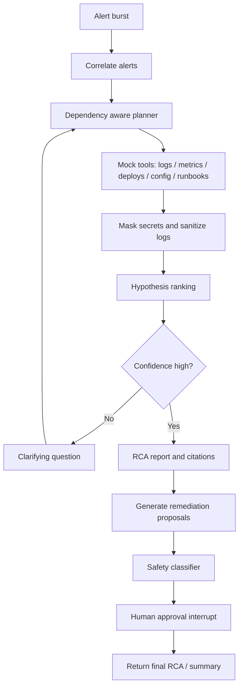

# Design Note

## Goal

The project is a production-minded prototype for autonomous incident triage and root-cause analysis. The goal is to reduce alert-storm triage time by correlating related alerts, investigating the most plausible failure chain, and producing a defendable RCA with evidence citations and human approval gates.

## Implemented architecture

The implementation uses a small custom Python orchestrator rather than LangGraph. `IncidentTriageAgent` owns the dependency graph, per-run tool-call budget, deduplication cache, retrieved evidence, model-ranked hypotheses, trace events, questions, and remediation plan. The flow is bounded: correlate alerts, select relevant services/tools, retrieve evidence once per unique query, mask/sanitize it, request a schema-constrained top three from local Qwen3, retrieve a runbook, and produce a report. The stop conditions are the 12-call tool cap and the single bounded model request.

The system is intentionally split into:

- intake and correlation layer
- dependency-aware evidence planner
- mock observability tools
- guardrail layer
- hypothesis reasoning and ranking
- deterministic action classifier and approval requirements
- evaluation harness

## Why this structure

The key challenge is controlling the investigation path and making the result inspectable. This POC plans a bounded set of relevant in-process evidence queries and emits tool calls, evidence IDs, ranked hypotheses, and citations in its trace. It does not implement a general graph framework, persistent checkpointing, or resumable interrupts; those are production follow-ups.

## Trade-offs and assumptions

1. Local model choice: The project uses Ollama + Qwen3 (4B) as the default model, but the LLM is abstracted behind a provider interface so replacing it with Azure OpenAI or another provider is a configuration change rather than a rewrite. The trade-off is that the smaller model may require more structured prompting and a narrower evidence schema.
2. Mock tools: The mock evidence layer is intentionally in-process and synthetic. This keeps the project self-contained and easy to demo, but it does not replace real telemetry integrations in production.
3. Budgeting: Each incident has a maximum of 12 tool calls; the model request uses a 4096-token context and at most 512 generated tokens. Evidence and alert text sent to the model are capped. CPU-only Qwen3 can still be slow, so the demo should be run one scenario at a time before the full evaluation.
4. Hidden scenario assumption: The implementation deliberately reasons from observed evidence and not from lookup tables keyed to the eight categories, so it can generalize beyond the known root-cause labels.

## Guardrails and safety

Safety is enforced in code rather than delegated to the LLM. The project contains a deterministic action classifier with tiers:

- Safe: restart pod, clear cache, flush cache
- Risky: rollback, config change, drain node
- Forbidden: delete data, drop table, purge queue, disable auth

The report marks each proposed action with its deterministic tier, approval requirements, and `never_executed_by_agent` status. The tested authorization helper rejects unapproved Safe actions, Risky actions without written justification, and every Forbidden action even when approved. There is no executor in this POC, so approval does not trigger an operation.

Secret masking and injection sanitization are deterministic pre-processing steps before logs and alert messages are included in the Qwen3 request. The CLI trace contains the sanitized/masked evidence. No external observability exporter is currently configured, so hosted-trace masking has not been exercised.

## Operational considerations for production

To run this in real production, the following would need to change:

- replace mock tools with authentic telemetry adapters and live dependency metadata
- add persistent trace storage/export (for example, LangSmith, Langfuse, or OpenTelemetry) and verify masking before export
- introduce a robust model failover strategy when the local model is unavailable or underperforming
- scale the alert-correlation logic across real time-series data and message-burst detectors
- implement a resumable human approval UI/workflow and formalize on-call ownership

The major cost drivers are model inference, telemetry ingestion, and tool-call volume. Without a strict budget and sampling strategy, large-scale alert storms would generate excessive cost and latency.

## Known limitations

- The implementation is synthetic and has not been validated against real incident data.
- The evaluation must be run on the current model/runtime before quoting accuracy; fixture labels and aliases are a small benchmark, not proof of generalization.
- Correlation precision is bounded by the labeled synthetic alert groups and graph topology.
- Reasoning traces expose evidence, support, and contradictions, not private chain-of-thought.
- The Qwen3 4B model is CPU-bound on this workstation and inference can be slow.
- External observability export, persistent checkpoints, a real approval UI, and action execution are not implemented.
- The LLM proposes hypotheses only; code validates schema/citations and owns action safety.

## Architecture diagram

**Simple understanding**
__AI-driven incident triage and RCA pipeline__:

1. A burst of alerts comes in.
2. Alerts are correlated into one incident context.
3. A dependency-aware planner decides what to check next.
4. It gathers evidence from tools (logs, metrics, deploys, config, runbooks).
5. Sensitive data is masked/sanitized.
6. Possible root-cause hypotheses are ranked.
7. Decision point:

   - __If confidence is low__ → ask a clarifying question, then loop back to planning.
   - __If confidence is high__ → generate RCA report with citations.
8. Propose remediation actions.
9. Run safety classifier on proposed actions.
10. Require human approval (interrupt).
11. Return final RCA/summary.
